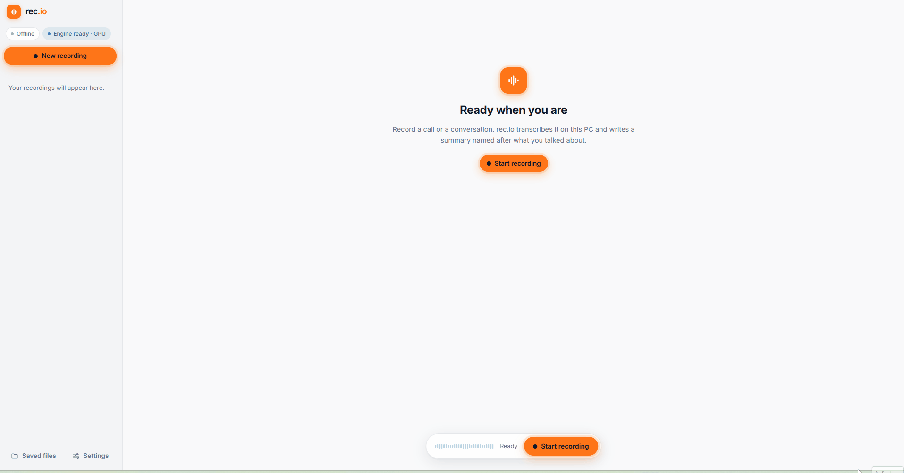

# rec.io

[](https://github.com/sirmachinealess/rec-io/actions/workflows/test.yml)
[](LICENSE)

**An offline meeting recorder for Windows.** It transcribes your calls live and writes a structured summary (decisions, action items, open questions) when you stop. Everything runs on your own PC: no account, no API key, and no audio or text ever leaves the machine.



**At a glance:** Windows 10/11 · NVIDIA GPU with **6 GB VRAM minimum, 8 GB recommended** · ~1 GB VRAM while recording, ~4.4 GB peak for a few seconds while the summary is written (the summary model is unloaded afterwards) · ~330 ms per speech segment on an RTX 2060 SUPER · ~5 GB disk for engines and models · optional speaker separation runs on the CPU after Stop: ~3.6 min per hour of call, ~0.7 GB extra RAM, no VRAM. Measured on an RTX 2060 SUPER (8 GB); CPU-only works with a smaller Whisper model but is too slow for live use.

> Works with Zoom, Teams, Meet or any other call app. rec.io records the computer's sound and your microphone; nothing joins the call.

## Why I built it

AI meeting notes are useful, but most tools send your audio to the cloud. I wanted the same result for meetings and language lessons without any of it leaving my laptop, so I built one around open models that run locally on a consumer GPU.

## Features

- **Live transcription** with [whisper.cpp](https://github.com/ggml-org/whisper.cpp) (`large-v3-turbo`, multilingual, auto language detection). About 330 ms per speech segment on an RTX 2060 SUPER.
- **Me / Them labels**: the microphone and the system sound are recorded as separate sources.
- **Speaker separation** (optional): after Stop, the other side of the call is split into **Speaker 1, Speaker 2, …**, so the summary can say who agreed to what. Rename a speaker ("Speaker 1" → "Alan") or merge two that are the same person on the recording page, without the audio; a rename updates the summary at once.
- **Structured summaries** with a local LLM ([Qwen3-4B-Instruct-2507](https://huggingface.co/Qwen/Qwen3-4B-Instruct-2507) via [llama.cpp](https://github.com/ggml-org/llama.cpp)): title, overview, topics, decisions, action items (task, owner, due date) and open questions. Action items appear only when someone actually committed to something, with the speaker's label or name as owner.
- **Language-lesson mode**: turns a class recording into study notes with grammar rules, a vocabulary table (article, plural, meaning, example), corrections, exercises and homework.
- **Long meetings**: transcripts longer than the model's context are summarized in parts and then merged.
- **Export** to PDF or TXT. Every recording is also saved as a readable Markdown file named after its topic.
- Light and dark mode; custom vocabulary so names and technical terms are spelled correctly.

## How it works

```
mic ───┐                          ┌─ Segmenter (VAD) ─┐
       ├─ AudioWorklet 16k PCM ───┤  per source       ├─► WAV ─► whisper-server on 127.0.0.1 (GPU)
system ┘  (WASAPI loopback)       └───────────────────┘                    │ text
                                                                            ▼
                                    TranscriptStore: partial (faded) → final, Me/Them by time
                                                     │  on Stop
                                                     ▼
              (optional) speaker separation of the system audio, CPU worker ─► Speaker 1, 2, …
                                                     │
                                                     ▼
                               llama-server (Qwen3-4B) ─► JSON-schema summary ─► Markdown / PDF
```

1. An energy-based voice activity detector cuts each audio stream into speech segments (32 ms hops, a segment closes after 0.8 s of silence, hard cut at 25 s).
2. Each segment is sent to a local `whisper-server`. Live partials appear faded and become solid once the final text arrives.
3. When you click **Stop**, the transcript is shown right away. With speaker separation on, the other side is split into speakers first (see below).
4. rec.io then starts `llama-server`, generates the summary, and shuts the model down again so it never holds GPU memory during a recording.

### Speaker separation

[sherpa-onnx](https://github.com/k2-fsa/sherpa-onnx) runs [pyannote segmentation 3.0](https://huggingface.co/pyannote/segmentation-3.0) and the [3D-Speaker](https://github.com/modelscope/3D-Speaker) CAM++ speaker model on the CPU, in a worker thread, so the app stays usable and the GPU stays free.

- **Audio is kept only until then.** While recording, only the system channel is written to a temporary file; the microphone never is. The file is deleted when separation ends, also when it fails, and leftovers from a crash are removed on the next start.
- **Against over-splitting.** Clustering alone found 7 to 15 "speakers" in 3-person test calls (laughter, music and crosstalk form their own clusters). A second pass computes one voice fingerprint per found speaker from up to 60 s of its audio, moves speakers with under 3 s or 4% of the speech to the nearest one, then joins speakers that sound at least 0.5 alike. On English and German test calls this found the right 3 speakers. Telling rec.io the number of people before **Start** ("People on the other side") is more reliable still, and it has to be before: the audio is gone afterwards.
- **Labels, not audio.** Each transcript line gets the speaker whose speech overlaps it most. The labels live in `speakers.json`; the transcript is never rewritten, so renames and merges are instant and can be undone.
- **Measured** on an i7-10700K (8 threads): ~56 s for a 15-minute call, ~3.6 min for an hour, ~0.7 GB extra RAM at peak, no change in GPU memory.

The models (36 MB) are downloaded once with **Set up speaker separation**; every file is SHA-256-verified and installed with its licence (MIT, Apache-2.0).

### Making a small model reliable

A 4B model running locally drifts and invents things, so the summary model's output is constrained by a **JSON schema**, and several steps are checked in code instead of trusted to the model:

- The schema caps the number of topics by length (3 to 5 under 15 minutes): given the count only in the prompt, the model wrote 12 topics for a 5-minute call.
- Topics about the conversation itself ("Tone and style", "Group appreciation") and points repeated under another topic are removed after the model.

In lesson mode:

- A second, narrow pass translates only the explanation fields. Words in the language being taught, and every number, are **masked** so the model cannot change them (German number words are converted to digits first).
- Example sentences are kept **only if they were actually said**, checked against the transcript.
- A plural the teacher said out loud (*"die Erfahrungen"*) **overrides** the model's guess.

### How it stays offline

- The UI's Content-Security-Policy sets `connect-src 'none'`, so the page cannot make network requests.
- The main process cancels every request that is not a local file or `127.0.0.1` / `localhost`.
- Spellcheck is disabled, because Chromium would download dictionaries.
- `whisper-server` and `llama-server` listen on `127.0.0.1` only, on random ports.

The only network access is the one-time model downloads (summaries, speaker separation), and only when you start them.

## Requirements

- Windows 10 or 11 (system audio is captured through WASAPI loopback)
- An NVIDIA GPU with at least 6 GB VRAM (8 GB recommended). rec.io uses about 1 GB while recording and peaks at about 4.4 GB for a few seconds while writing the summary. On CPU only, use a smaller Whisper model (see below).
- About 5 GB of free disk space for the engines and models
- Speaker separation (optional) needs no GPU: it uses the CPU after Stop, about 3.6 min per hour of call and about 0.7 GB of extra RAM (measured on an i7-10700K)
- Microsoft Visual C++ 2015–2022 runtime (already present on most PCs)
- Node.js (current LTS) and npm to build from source

## Getting started

```bash
git clone https://github.com/sirmachinealess/rec-io.git
cd rec-io
npm install
npm run setup-local   # downloads whisper.cpp, cuBLAS and the Whisper model into local/ (~1.3 GB)
npm start
```

Wait for **Engine: ready · GPU (CUDA)**, then click **Start**. The summary engine (llama.cpp and Qwen3-4B, ~3.2 GB, every file SHA-256-verified) is downloaded once from inside the app with **Set up summaries**.

To use a smaller Whisper model, for example on a machine without an NVIDIA GPU, put it in `local/models/` and run:

```bash
set WHISPER_MODEL=ggml-small.bin && npm start
```

### Build a Windows installer

```bash
npm run dist
```

This creates `dist/rec.io-Setup-<version>.exe` with the transcription engine bundled. The installer is not code-signed, so Windows SmartScreen will warn on first run (**More info → Run anyway**).

## Where your recordings are saved

```
%APPDATA%\rec.io\meetings\
  2026-10-20 21.44 – Project timeline and design document update.md   ← summary + transcript
  .data\<recording id>\meta.json, transcript.jsonl, summary.json      ← raw data used by the app
                       speakers.json                                  ← speaker labels and names, if separated
```

Recordings stay on your PC and are kept when you uninstall the app. No audio is ever kept: the temporary call audio for speaker separation lives in `%APPDATA%\rec.io\tmp\` only until separation ends.

## Project structure

| Path | Role |
|---|---|
| `src/main.js` | Electron main process: window, loopback capture, network lock, IPC, saving |
| `src/whisper-server.js` | Starts whisper-server (CUDA, else CPU), queues `/inference` requests, filters `[BLANK_AUDIO]`-style output |
| `src/llama-server.js` | Starts and stops llama-server; JSON-schema chat completions |
| `src/summarize.js` | Single-pass or multi-part summaries, lesson-mode checks |
| `src/summary-format.js` | Schemas, prompts and Markdown rendering |
| `src/summary-pack.js` | One-time, checksum-verified download of the summary engine |
| `src/meetings.js` | Per-recording storage and topic-based file names |
| `src/temp-audio.js` | Temporary system audio for speaker separation, deleted afterwards |
| `src/diarize.js`, `src/diarize-worker.js` | Speaker separation in a worker thread (sherpa-onnx) |
| `src/speaker-merge.js` | Second pass against over-splitting: tiny speakers, similar speakers, known count |
| `src/speakers.js` | Speaker labels on the transcript; rename and merge |
| `src/speaker-pack.js` | One-time, checksum-verified download of the speaker models |
| `scripts/diarize-eval.mjs` | Developer tool to compare separation settings on test recordings |
| `src/export-format.js`, `src/pdf-export.js` | TXT and PDF export |
| `src/renderer/segmenter.js` | Energy-based voice activity detection |
| `src/renderer/local-asr.js` | Orders final segments; schedules live partials |
| `src/renderer/transcript.js` | Live merge of partial and final transcript chunks |
| `test/` | Unit tests (`npm test`) |

## Known limits

- Use headphones: speaker audio leaking into the microphone is transcribed twice.
- The voice detection is energy-based, so a loud fan or music can open segments. Whisper usually returns nothing for those, and that output is filtered. [Silero VAD](https://github.com/snakers4/silero-vad) would be the upgrade.
- Whisper occasionally invents a short phrase from microphone noise. Filtering on its no-speech probability would remove most of these.
- The first run after installing or updating the GPU driver spends ~30 s compiling CUDA kernels.
- In lesson mode, plurals the teacher did not say come from the model and can be wrong.
- Speaker separation: with "People on the other side" on Auto, a noisy call can still get one speaker too many or too few; merge or rename on the recording page. When two people talk at once, the line goes to whoever spoke more of it. Your own microphone is always "Me".

## Roadmap

- [ ] Silero VAD instead of the energy-based detector
- [ ] Measured transcription accuracy (word error rate) on a small test set
- [x] Speaker separation within the "Them" channel
- [ ] macOS support

## Built with

[whisper.cpp](https://github.com/ggml-org/whisper.cpp) · [llama.cpp](https://github.com/ggml-org/llama.cpp) · [Qwen3](https://github.com/QwenLM/Qwen3) · [sherpa-onnx](https://github.com/k2-fsa/sherpa-onnx) · [pyannote segmentation 3.0](https://huggingface.co/pyannote/segmentation-3.0) (MIT) · [3D-Speaker CAM++](https://github.com/modelscope/3D-Speaker) (Apache-2.0) · [Electron](https://www.electronjs.org/) · [Inter](https://rsms.me/inter/) (SIL Open Font License)

I built rec.io with [Claude Code](https://claude.com/claude-code) as my pair programmer.

## License

[MIT](LICENSE) © 2026 Felipe Silva. Models downloaded at setup keep their own licenses: Whisper (MIT), Qwen3 (Apache 2.0). NVIDIA cuBLAS is downloaded from NVIDIA under its own license.
